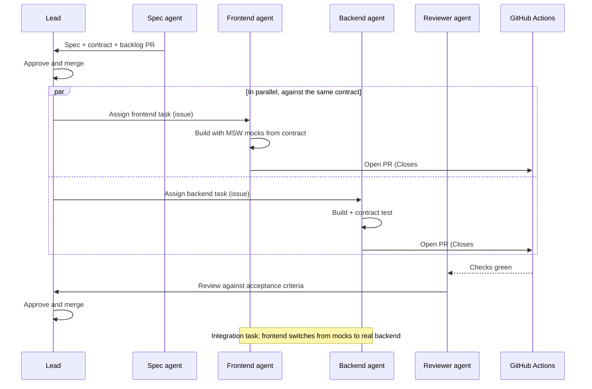

# MediTrack — Agent Team

MediTrack is built by one human lead and a small team of AI agents. Each agent has a narrow job, owns specific files, and hands work back through pull requests. No agent merges or deploys its own work.

## 1. Roles

| Role | Who | Responsibilities | Owns (write access) |
|---|---|---|---|
| **Lead** | Brave (human) | Approves requirements, contract and backlog; assigns tasks; approves and merges PRs; approves production deploys; holds all secrets | Everything; final say |
| **Spec agent** | AI session (planning) | Drafts and maintains specs, ADRs and backlog tasks; reviews contract-change requests; keeps docs consistent | `docs/**`, `prompts/**`, `api/openapi.yaml`, `backlog/**`, `scripts/create_backlog.py`, `scripts/render_backlog.py`, `scripts/check_docs.py`, `AGENTS.md`, `CLAUDE.md`, `README.md` — **by PR, Lead approves** |
| **Frontend agent** | AI coding session | Builds the React app against the contract; frontend unit/component tests; frontend Dockerfile and its nginx config | `frontend/**` |
| **Backend agent** | AI coding session | Builds the FastAPI app, domain rules, database, migrations, backend tests, backend telemetry; backend Dockerfile | `backend/**` |
| **Reviewer agent** | Fresh AI session with **no** shared context with the author | Reviews each PR against its task's acceptance criteria and the rules in AGENTS.md; read-only | None (comments only) |
| **Test agent** *(risk tasks)* | Fresh AI session, never the implementer of the same task | Writes acceptance tests for the riskiest rules (time, status, log window, duplicates, concurrency) **before** they are implemented, from the acceptance criteria only; they land on `main` as strict expected failures | `backend/tests/acceptance/**`, `frontend/src/test/acceptance/**` |
| **Platform agent** *(phase 2)* | AI coding session | Docker Compose, Makefile, CI/CD workflows, nginx, observability config, alert rules | `docker-compose*.yml`, `Makefile`, `.github/workflows/**`, `deploy/**`, `probe/**`, `responder/**`, `scripts/**` (except the three spec scripts owned by the Spec agent), repository guardrails from MT-004: `.pre-commit-config.yaml`, `.github/CODEOWNERS`, `.github/dependabot.yml`, and `.editorconfig` (a root file, see §2) |
| **Responder agent** *(phase 3, runtime)* | Automated service in production | Reacts to the user-impact alert using the runbook; one bounded action | None — built by the Platform agent; at runtime it writes nothing to the repo (only issues/comments) |

Excellence editions, used for MT-020 and for MT-011 onwards on top of the base prompts (quality bar, Phase A design note, self-review loop): [prompts/frontend-agent-excellence.md](../prompts/frontend-agent-excellence.md), [prompts/backend-agent-excellence.md](../prompts/backend-agent-excellence.md).

Ready-to-use base prompts: [prompts/frontend-agent.md](../prompts/frontend-agent.md), [prompts/backend-agent.md](../prompts/backend-agent.md), [prompts/reviewer-agent.md](../prompts/reviewer-agent.md), [prompts/test-agent.md](../prompts/test-agent.md).

## 2. File ownership rules

- An agent edits **only** files it owns. If it needs a change elsewhere, it opens an issue (or PR comment) and keeps going on other work.
- **Shared contract:** `api/openapi.yaml` is owned by the Spec agent/Lead. Frontend and Backend agents **never edit it**. They raise a `contract-change` issue describing the change and why.
- `frontend/src/api/schema.d.ts` is generated from the contract; nobody edits it by hand.
- **Acceptance tests written by the Test agent** (`backend/tests/acceptance/**`, `frontend/src/test/acceptance/**`) are merged as strict expected failures (`@pytest.mark.xfail(strict=True, reason="MT-0xx")`, or `it.fails` in Vitest). The implementing agent may only **remove that marker** once its code makes the test pass. Any other change to those files needs the Test agent's or the Lead's approval, which the Reviewer checks in the diff.
- Root files (`.gitignore`, `.env.example`, `.editorconfig`) change only through Lead-approved PRs.

## 3. How the agents work together

1. **Spec first.** No feature code until the Lead merges the spec, contract and backlog.
2. **Parallel build.** The Frontend agent uses MSW mocks generated from contract examples, so it doesn't wait for the backend. The Backend agent proves conformance with the contract test.
3. **Integration point.** Task MT-030 connects the real frontend to the real backend in Docker Compose and runs the end-to-end smoke test.
4. **Contract changes.** Agent opens `contract-change` issue → Spec agent drafts a PR to `api/openapi.yaml` → Lead approves → both agents update (frontend regenerates types).

## 4. Task lifecycle and tracker evidence

Every agent follows the same loop for one task at a time:

1. Read the GitHub issue (task ID `MT-xxx`), its acceptance criteria, and its verification commands.
2. Comment on the issue: "Starting MT-xxx" with a short plan.
3. Branch: `mt-xxx-short-name` (e.g. `mt-012-dose-log-endpoint`).
4. Commits start with the task ID: `MT-012: add unique constraint for dose logs`.
5. Run the task's verification commands locally and paste the results into the PR.
6. Open a PR using the template, with `Closes #<issue>`.
7. Comment on the issue with a hand-off note: what was done, what wasn't, open questions.

This trail (issue comments, branch names, commit prefixes, linked PRs) is the evidence that the agents used the tracker.

## 5. Permissions

| Capability | Lead | Spec | Frontend | Backend | Reviewer | Test | Platform | Responder (prod) |
|---|---|---|---|---|---|---|---|---|
| Read repo | ✓ | ✓ | ✓ | ✓ | ✓ | ✓ | ✓ | ✓ (read API) |
| Push to feature branch | ✓ | ✓ | ✓ | ✓ | ✗ | ✓ | ✓ | ✗ |
| Push to `main` | ✗ (PR only) | ✗ | ✗ | ✗ | ✗ | ✗ | ✗ | ✗ |
| Merge PR | ✓ | ✗ | ✗ | ✗ | ✗ | ✗ | ✗ | ✗ |
| Edit `api/openapi.yaml` | ✓ | ✓ (PR) | ✗ | ✗ | ✗ | ✗ | ✗ | ✗ |
| Run local tests / Docker | ✓ | ✓ | ✓ | ✓ | ✓ | ✓ | ✓ | ✗ |
| Access secrets | ✓ | ✗ | ✗ | ✗ | ✗ | ✗ | ✗ | Only its own scoped token |
| Deploy to dev | Auto on merge | ✗ | ✗ | ✗ | ✗ | ✗ | ✗ | ✗ |
| Deploy to production | ✓ (approve) | ✗ | ✗ | ✗ | ✗ | ✗ | ✗ | ✗ |
| Trigger rollback | ✓ | ✗ | ✗ | ✗ | ✗ | ✗ | ✗ | ✓ once per incident |
| Create issues / comment | ✓ | ✓ | ✓ | ✓ | ✓ | ✓ | ✓ | ✓ |

Enforce what GitHub can enforce: branch protection on `main` (PR required, status checks required, at least one approval) and required reviewers on the `production` environment. Check these settings exist on your plan and repository visibility before relying on them.

## 6. Verification of agent work

An agent's claim that something works is not evidence. Evidence is:

- CI checks passing on the PR (lint, type check, tests, contract test, build).
- Verification command output pasted in the PR, matching what CI shows.
- A Reviewer agent report that checks each acceptance criterion and lists anything untested.
- For UI tasks: a screenshot or short recording in the PR.
- For risk tasks (MT-011, MT-012, MT-016, MT-025): acceptance tests written **beforehand by a different session** (Test agent, task MT-008) that the implementation turned from expected-fail to pass, so the tests weren't shaped to fit the code.

## 7. Enforcing the rules in the tools

Documented rules are backed by settings where the tools allow it (task MT-005):

- **GitHub:** protected `main` (PR, required checks, one approval, no force push), `production` environment with the Lead as required reviewer, CODEOWNERS making the Lead a required reviewer for `api/`, `AGENTS.md`, migrations, `.github/`, `responder/` and `frontend/src/copy.ts`.
- **Claude Code:** one agent definition per role in `.claude/agents/` (tool list and owned paths) and deny rules in `.claude/settings.json`: no reading `.env*`, no `git push` to `main` or `--force`, no `gh pr merge`, `gh secret` or `gh workflow run`. Other tools get the same rules through `AGENTS.md` and the prompts in `prompts/`.
- **Ownership check:** `scripts/check_ownership.py` runs in CI and flags PRs labelled `role:<x>` that touch paths outside that role (warning first, blocking once stable).

Details: [development-workflow.md](development-workflow.md#8-review-of-ai-generated-work).
