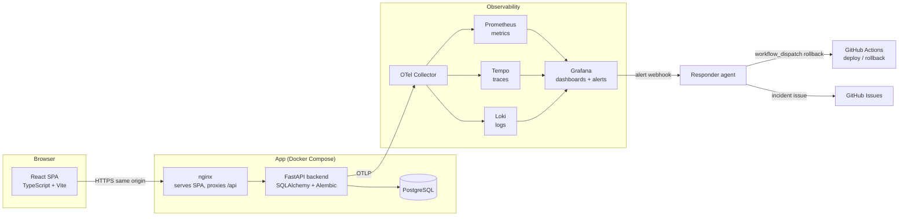

# MediTrack — Architecture

Status: **v1.0 — approved 2026-10-26 (MT-001)**. All ADRs below are Accepted; new decisions are appended by PR.

## 1. System overview



## 2. Components

| Component | Tech | Responsibility | Owner agent |
|---|---|---|---|
| Frontend | React, TypeScript, Vite, React Router, Vitest, React Testing Library, MSW | Screens, accessibility, calling the API with generated types | Frontend |
| Backend | Python 3.12, FastAPI, Pydantic v2, SQLAlchemy 2, Alembic, pytest | API, dose-status rules, persistence, telemetry | Backend |
| Database | PostgreSQL (Compose and deployed); SQLite for fast unit tests and optional no-Docker dev | Persistent storage | Backend |
| Web server | nginx container (`frontend/Dockerfile`, `frontend/nginx.conf`) | Serves the built SPA and proxies `/api`, `/healthz`, `/readyz` to the backend | Frontend |
| Observability | OpenTelemetry SDK, OTel Collector, Prometheus, Tempo, Loki, Grafana | Metrics, traces, logs, dashboards, alerting | Platform (phase 2) |
| Responder agent | Small Python service + `investigate.yml` workflow | Receives alert, gathers context, performs one bounded action (rollback); a headless coding agent investigates and may open a fix PR | Platform (phase 3) |

All versions are pinned in lockfiles when the agents create them. Check library APIs against current docs; don't rely on memory.

## 3. Backend structure

```
backend/
  app/
    main.py              # app factory, middleware, exception handlers
    config.py            # settings from environment variables
    clock.py             # Clock protocol + SystemClock + FixedClock (tests)
    api/                 # routers only: parse request, call service, map errors
    domain/
      scheduling.py      # PURE functions: planned doses, DST policy, status
      adherence.py       # PURE functions: daily summary
    services/            # use cases; transactions; raise domain errors
    db/
      models.py          # SQLAlchemy models
      session.py
      repositories.py
    telemetry.py         # OTel setup, privacy-safe attributes
  alembic/
  tests/
    unit/  integration/  contract/
```

Rules:

- `domain/` has no imports from FastAPI, SQLAlchemy or the system clock. Every function takes `now` or a `Clock` explicitly.
- Instants are stored as UTC. Read paths must return timezone-aware UTC datetimes on **both** SQLite and PostgreSQL (SQLite has no native timezone type, so normalise on read).
- `times_of_day` and `days_of_week` are stored as JSON columns so the same schema works on SQLite and PostgreSQL.
- Unique constraint `uq_dose_log_schedule_time (schedule_id, scheduled_for)` enforces duplicate prevention. The service catches the integrity error and raises `DuplicateDoseLog` → 409.

## 4. Frontend structure

```
frontend/
  src/
    api/
      schema.d.ts        # GENERATED from api/openapi.yaml — never edited by hand
      client.ts          # typed fetch wrapper, problem+json handling
    pages/               # PatientsPage, TodayPage, MedicationsPage, MissedPage, SummaryPage
    components/          # DoseCard, StatusBadge, Disclaimer, ...
    mocks/               # MSW handlers built from contract examples
  tests/
```

- Types come from the contract (for example with `openapi-typescript`; verify the current CLI usage in its docs).
- All dates shown for a patient use the patient's timezone from the API, not the browser's.
- No telemetry is sent from the browser in v1.

## 5. Environments

| Environment | How it runs | Database | Data |
|---|---|---|---|
| Local | `docker compose up --build` (or `make up`) | PostgreSQL container, named volume | Synthetic seed |
| CI | GitHub Actions | SQLite for unit tests; PostgreSQL service container for integration tests | Test fixtures |
| Dev (deployed) | Auto-deploy on merge to `main` | Managed or containerised PostgreSQL | Synthetic seed |
| Prod (deployed) | Manual approval in GitHub Environments | Separate PostgreSQL | Synthetic demo data only |

## 6. Deployment options

**Decision D2 (2026-10-26): option A**, one small Linux VM running Docker Compose, with option B as the fallback. Provider: **AWS Lightsail 4 GB** (US$24/month), chosen from the price check in §6.1; MT-033 creates it. Prices and free tiers change often, so re-check the provider's pricing page on the day you buy.

| Option | How | Pros | Cons |
|---|---|---|---|
| **A. One small Linux VM** (recommended if you can get one) | Docker Compose on the VM; Caddy or nginx for HTTPS; dev and prod as two Compose projects on two subdomains; GitHub Actions deploys over SSH | Full observability stack runs next to the app; same Compose file as local; simple rollback | You manage the VM and TLS |
| **B. PaaS** (e.g. Google Cloud Run, Render, Fly.io, Railway) + managed PostgreSQL (e.g. Neon free tier, one branch per environment) | Deploy the images; telemetry goes to a hosted backend such as Grafana Cloud; the responder runs as a GitHub Actions workflow triggered by the alert webhook (`repository_dispatch`) | Little ops work; HTTPS included; Cloud Run keeps revisions, so rollback is a traffic switch | Free tiers may sleep (Render's free instances spin down when idle, and cold starts can trip the probe) or expire; Cloud Run needs a billing account; observability needs a hosted service and an API token |
| **C. Local demo only** (fallback) | Record a video of the full flow running locally, including the alert and rollback | No cost | Scores lower on the Deployment criterion (1 point instead of 2 unless the demo clearly shows a deployment) |

### 6.1 Price check (2026-10-26)

Target size: at least 2 vCPU, 4 GB RAM and 40 GB disk with a public IPv4. Two Compose projects plus the Grafana stack need about 2.5–3 GB. Prices are from each provider's own pages on 2026-10-26, excluding VAT. The two figures marked ✔ were re-checked directly.

| Provider / plan | Monthly | vCPU / RAM / disk / traffic | Notes |
|---|---|---|---|
| **AWS Lightsail** 4 GB | **$24** with IPv4 ✔ ($20 IPv6-only) | 2 / 4 GB / 80 GB / 4 TB, x86 | AWS Free Tier for new accounts: about $100 credit (up to $200), 6 months. Most new customers need no payment method. A free-plan account closes when the credits run out or after 6 months. Regions in Asia, South America and elsewhere. **Chosen (D2)**: two months of the course are about $48, which the credit covers. |
| Akamai/Linode 4 GB | $24 | 2 / 4 GB / 80 GB / 4 TB, x86 | $100 new-user credit (60 days, card required). **Runner-up.** |
| Vultr regular 2c/4 GB | $20 ($30 São Paulo) | 2 / 4 GB / 80 GB / 3 TB, x86 | Cheapest without credits; IPv4 inclusion only partly verified |
| DigitalOcean Basic 4 GiB | $24, IPv4 included | 2 / 4 GiB / 80 GiB / 4 TB, x86 | Billed per second; no sign-up credit confirmed |
| Hetzner CX23 / CAX11 | €5.49 / €5.99 ✔ + €0.50 IPv4 | 2 / 4 GB / 40 GB / 20 TB | **Prices rose on 15 Jun 2026** (from €3.99 / €4.49), and both were listed as currently not orderable. Cheapest if they come back; check the console. |
| Hetzner CPX22 | €19.49 ✔ + €0.50 IPv4 | 2 / 4 GB / 80 GB | Was €7.99; Hetzner's status page reports limited availability |
| Oracle Always Free A1 | $0 | **2 OCPU / 12 GB** now (no longer 4 / 24), ARM | Instances idle for 7 days can be reclaimed; "out of host capacity" errors; card required. Not recommended for a graded deadline. |
| GCP e2-micro (free) | $0 | 1 GB RAM | Too small |

Fallback B pieces: Render free web services sleep after 15 minutes and free Postgres expires after 30 days (Starter $7/mo, Postgres $6/mo). Fly.io has no free tier (machines from about $2–7/mo; managed Postgres from $38/mo). Railway Hobby is $5/mo, including $5 of usage. The Cloud Run free tier needs a billing account. Neon free tier: 1 GB per project, sleeps after 5 minutes. Grafana Cloud free tier: 10k metric series, 50 GB logs and 50 GB traces, 14-day retention.

**AWS credit terms** (from AWS's own pages on 2026-10-26; re-read them on the day you sign up):

- **Amount:** every new AWS account gets **US$100 in credits** at sign-up, on either plan, plus up to US$100 more for completing "Explore AWS" activities within 6 months. Credits are applied automatically to charges of participating services. Lightsail's FAQ says you can "get started with Amazon Lightsail for free with the AWS Free Tier where you can get up to $200 USD in free AWS credits".
- **Free plan** (the default): nothing is ever charged. It ends after **6 months or when the credits are used up, whichever comes first**. The account then **closes automatically** and its resources and data become unreachable. AWS keeps the content for 90 days, and upgrading to the Paid plan in that time restores access; after that, everything is deleted.
- **Paid plan:** usage beyond the credit balance is billed to your card, and the account stays open when credits run out. Credits left over on upgrade carry over to future bills.
- **Expiry:** AWS's pages disagree. The general FAQ says credits expire 6 months after account creation, the Free Tier FAQ's answer to "What happens to my credits when I upgrade to Paid plan?" says 12 months, and activity credits expire 12 months after creation. Plan for 6.
- **Not confirmed by AWS:** whether the Free plan lets you create the 4 GB bundle (the Free plan covers "select" services, and no page lists Lightsail bundle sizes). If the console refuses it, upgrade to the Paid plan; your credits carry over.
- **Lightsail billing:** hourly up to the monthly price. Instances are billed **while stopped**, so delete one to stop paying. A static IP is free while attached and $0.005/hour if left unattached for more than an hour. Snapshots cost $0.05/GB-month.
- **What US$100 buys:** about 4 months of the 4 GB bundle on its own (US$24/month); snapshots and extra transfer come out of the same credit.

**Billing alarm, before you create the instance:** in Billing and Cost Management, create a monthly **cost budget of US$30** that tracks **unblended** cost (usage before credits, not "net unblended"). Under Budget scope → Filters → **Charge type**, also exclude **Credit** and **Refund**, because AWS Budgets counts credits unless told not to ([filters](https://docs.aws.amazon.com/cost-management/latest/userguide/budgets-create-filters.html)). Add email alerts at 100% of actual cost and 100% of forecasted cost. Expected usage is about US$24/month, so lower thresholds (50%, 80%) would fire every month by design. On the Free plan, AWS also emails you about the credit balance and the plan's end automatically. **If you move to the Paid plan, don't set its spend limit at the US$20 minimum.** AWS's FAQ says that when a project reaches its spend limit, AWS "will pause your project and stop its resources" until the next month, which would take dev and prod down mid-month and fire the user-impact alert. Set it to at least US$40, or leave it unset and rely on the budget. AWS doesn't say whether the limit counts usage before or after credits. Put a calendar reminder at month 3 to either upgrade or tear the VM down.

**Next step (Lead, MT-033):** create the AWS account, set the billing alarm, then create the Lightsail 4 GB instance in the region closest to you and your reviewers. No account or credential has been created by an agent.

**Sources** (checked 2026-10-26; ✔ = re-read directly, others gathered by a research session):
- AWS: [Lightsail pricing](https://aws.amazon.com/lightsail/pricing/) ✔ · [Lightsail billing FAQ](https://docs.aws.amazon.com/lightsail/latest/userguide/amazon-lightsail-frequently-asked-questions-faq-billing-and-account-management.html) ✔ · [Free Tier FAQs](https://aws.amazon.com/free/free-tier-faqs/) ✔ · [Choosing a plan (Free vs Paid)](https://docs.aws.amazon.com/awsaccountbilling/latest/aboutv2/free-tier-plans.html) ✔ · [AWS Free Tier](https://aws.amazon.com/free/) · [Lightsail regions](https://docs.aws.amazon.com/lightsail/latest/userguide/understanding-regions-and-availability-zones-in-amazon-lightsail.html)
- Hetzner: [price adjustment, 15 June 2026](https://docs.hetzner.com/general/infrastructure-and-availability/price-adjustment/) ✔ · [Cloud overview](https://www.hetzner.com/cloud/) · [cost-optimized plans](https://www.hetzner.com/cloud/cost-optimized/) · [regular-performance plans](https://www.hetzner.com/cloud/regular-performance/) · [IPv4 pricing](https://docs.hetzner.com/general/infrastructure-and-availability/ipv4-pricing/) · [status page](https://status.hetzner.com/)
- DigitalOcean: [Droplet pricing](https://www.digitalocean.com/pricing/droplets) · [regions](https://docs.digitalocean.com/platform/regional-availability/)
- Vultr: [plans API](https://api.vultr.com/v2/plans) (the pricing website blocks scripted requests) · Akamai/Linode: [pricing](https://www.akamai.com/cloud/pricing) (blocks scripted requests; read in a browser)
- Oracle: [Always Free resources](https://docs.oracle.com/en-us/iaas/Content/FreeTier/freetier_topic-Always_Free_Resources.htm) · Google Cloud: [free features](https://cloud.google.com/free/docs/free-cloud-features) · [Cloud Run pricing](https://cloud.google.com/run/pricing)
- Fallback B: [Render free tier](https://render.com/docs/free) · [Render pricing](https://render.com/pricing) · [Fly.io pricing](https://fly.io/docs/about/pricing/) · [Railway pricing](https://railway.com/pricing) · [Neon pricing](https://neon.com/pricing) · [Neon plans](https://neon.com/docs/introduction/plans) · [Grafana Cloud pricing](https://grafana.com/pricing/)

## 7. Architecture decision records

Each ADR: context → decision → consequences. New ADRs are appended here by PR.

### ADR-001 Contract-first API (Accepted)
- **Context:** Two agents build the frontend and backend in parallel.
- **Decision:** `api/openapi.yaml` is the source of truth. The frontend generates types from it; the backend is checked against it with a contract test.
- **Consequences:** Contract changes need a Lead-approved PR before either side codes against them. Drift is caught in CI.

### ADR-002 Compute planned doses on read (Accepted)
- **Context:** Doses could be stored ahead of time by a scheduler, or computed from schedules when requested.
- **Decision:** Compute planned doses on read from schedules + dose logs + `now`. Store only dose logs.
- **Consequences:** No background job, no backfill, deterministic tests with a fixed clock. Ranges are capped (31 days) to bound cost.

### ADR-003 Duplicate prevention in the database (Accepted)
- **Decision:** Unique constraint on `(schedule_id, scheduled_for)`; integrity error → 409 `DUPLICATE_DOSE_LOG`. The UI also disables buttons while a request is in flight.
- **Consequences:** Safe under concurrent requests (AC-18), not just sequential ones.

### ADR-004 Time handling (Accepted)
- **Decision:** UTC instants in storage and API; schedule times are patient-local, converted with the pre-transition offset (`zoneinfo` `fold=0`: DST gap shifts forward by the gap length, overlap uses the first occurrence); a dose belongs to the local date on which it actually happens, so a gap that starts late in the evening can move a dose to the next day ([requirements §4.3](requirements.md#43-timezone-rules)); "today" is the patient's local date; timezone changes only allowed before any dose log exists.
- **Consequences:** Uses Python `zoneinfo`; requires timezone data in the container image (verify `tzdata` is available in the chosen base image).

### ADR-005 PostgreSQL in Compose and deployment, SQLite for fast tests (Accepted)
- **Context:** The proposal lists SQLite for local use. The concurrency test (AC-18) and production parity need PostgreSQL.
- **Decision:** Docker Compose runs PostgreSQL. SQLite stays available for unit tests and optional no-Docker development. Integration tests run on PostgreSQL in CI.
- **Consequences:** Schema must avoid database-specific types (JSON columns, no PostgreSQL arrays).

### ADR-006 Same-origin serving (Accepted)
- **Decision:** nginx serves the SPA and proxies `/api` to the backend. Vite's dev proxy does the same locally.
- **Consequences:** No CORS configuration needed; one public URL.

### ADR-007 No authentication in v1 (Accepted — decision D1)
- **Decision:** v1 has no accounts. Demo data is synthetic and is **reset to the seed on every deploy and every night** (FR-14). Every page shows a banner warning not to enter real health information (FR-13).
- **Consequences:** Must be stated in README limitations. Visitors share the demo data until the next reset. Accounts are FR-12 (P2).
- **Later option (not v1):** a private demo workspace per visitor, using a random token in an `HttpOnly; Secure; SameSite=Strict` cookie and no email or password. It would isolate visitors on the public demo without collecting credentials. It costs a `workspace_id` column, a filter on every query (foreign rows → 404) and an isolation test, and it touches every endpoint, so it was deferred.

### ADR-008 Immutable images and redeploy-based rollback (Accepted)
- **Decision:** Images are tagged with the Git SHA and pushed to GitHub Container Registry. Rollback = redeploy the last known-good SHA. Migrations follow expand/contract so the previous release still works with the newer schema.
- **Consequences:** Never drop or rename a column in the same release that stops using it.

### ADR-009 Bounded responder: deterministic rollback + investigation agent (Accepted with limits — decision D4)
- **Context:** The course scores an on-call agent that "wakes up on an alert and fixes the issue", and its DevOps module separates evidence, reasoning, permission and verification: a model supplies confidence, and code outside the model enforces permission.
- **Decision:** Two layers. (1) The responder service follows a fixed runbook and may take at most one automatic action per incident: roll back to the previous good release under the rules in operations.md §6.1. No model is involved. (2) An investigation agent (headless coding agent, decision D4) runs in an isolated GitHub Actions job on the live SHA, from a read-only, allowlisted evidence packet. It classifies the incident and, for a code defect, opens a PR with a failing-then-passing test. Its output is schema-checked and its PR is path- and size-limited; merging always needs the Lead.
- **Limits set by the Lead (D4):** the model ID is pinned in the workflow file (`claude-sonnet-5-5`, with `claude-opus-5-5` as the upgrade if the drill shows weak investigations) and changes only by PR. The API key belongs to a dedicated workspace with a hard monthly spend limit and is stored only as a `responder` environment secret. The agent starts in **report-only** mode (findings posted to the incident issue, no branch or PR), and PR mode is enabled by the Lead only after the drill works. It never merges, deploys or sees production secrets.
- **Consequences:** Service recovery never depends on a model. Hitting the spend limit only stops the investigation; the rollback still runs. The permanent fix is proposed automatically, once PR mode is on, but reviewed like any other PR. More moving parts (one extra workflow and a model API key), all unit-tested except the model call. Details in [operations.md §6](operations.md#6-responder-agent).

### ADR-010 OpenTelemetry with the Grafana stack (Accepted — decision D3)
- **Decision:** Backend emits OTLP traces, metrics and logs with a shared trace ID. Locally, an all-in-one Grafana/OTel image is used (for example `grafana/otel-lgtm`; verify the image and its current docs before use). Deployed, the same stack runs on the VM (D2). Grafana sits behind a login and is not publicly writable.
- **Consequences:** One UI (Grafana) for all signals and for alert rules.

### ADR-011 Independent review of AI-generated work (Accepted)
- **Decision:** No agent merges its own work. Every PR is checked by CI, reviewed by a fresh-context reviewer session against the task's acceptance criteria, and approved by the Lead. See [development-workflow.md](development-workflow.md#8-review-of-ai-generated-work).

### ADR-012 One schedule per medication per weekday at a time (Accepted — decision D5)
- **Context:** Ending a schedule today and starting a replacement today would put both on today's dose list (for example 08:00 already taken plus a new 09:00), inviting a double dose.
- **Decision:** Schedules of the same medication may not overlap in date range on a shared weekday (409 `SCHEDULE_OVERLAP`). Schedule changes therefore take effect from the next day; different times on the same days go in one schedule.
- **Consequences:** Simple, deterministic, testable (AC-34). Slightly less flexible: a same-day time change is not possible. Users log today's dose against the old time, which the 24-hour log window allows.

### ADR-013 One VM with Docker Compose for dev and prod (Accepted — decision D2)
- **Context:** The app, both environments, the Grafana stack, the responder and the probe all need to run somewhere that is cheap, reproducible from the repository, and close to the local setup.
- **Decision:** One small Linux VM (at least 2 vCPU, 4 GB RAM, 40 GB disk): **AWS Lightsail, 4 GB bundle** (2 vCPU, 4 GB, 80 GB SSD, 4 TB transfer, US$24/month), chosen from the price check in §6.1. Dev and prod are two Compose projects with separate databases and volumes, on two subdomains behind one reverse proxy with automatic HTTPS. The Grafana stack, responder and probe run on the same VM on an internal network. GitHub Actions deploys over SSH. Fallback: option B (hosted platform + managed PostgreSQL + hosted telemetry).
- **Consequences:** Local and deployed setups use the same Compose files; telemetry never leaves the VM. One VM is a single point of failure for both environments (accepted for a demo). The Lead patches the OS and keeps the SSH key only in the `dev`/`production` environment secrets.
