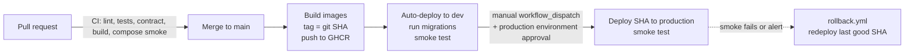

# MediTrack — Operations

Covers telemetry, the user-impact alert, deployment and rollback, the on-call responder agent, and the incident drill. Status: **v1.0 — approved 2026-10-26 (MT-001)**. Metric names and library options must be checked against current OpenTelemetry docs when implemented; names below are the intended design.

## 1. Key user journey

**"Record a dose"**: caregiver or patient opens Today → taps **Taken** → `POST /api/v1/dose-logs` → row written → day view refreshes (`GET /api/v1/patients/{id}/doses`).

If this fails, a dose may go unrecorded and a caregiver may think it was missed, or give it twice. That is the user impact we alert on — not CPU or memory.

## 2. Telemetry signals

All three signals carry the same **trace ID** so a failing request can be followed from the metric spike to the trace to the log line.

### 2.1 Traces

- Automatic spans: incoming HTTP requests (FastAPI instrumentation) and database calls (SQLAlchemy instrumentation), with SQL parameter capture **off**.
- Custom span `dose_log.create` with attributes: `meditrack.outcome` (`created` | `duplicate` | `rejected` | `error`), `meditrack.late` (bool), `meditrack.error_code` (contract `code`).
- Resource attributes: `service.name=meditrack-backend`, `service.version=<git sha>`, `deployment.environment=<local|dev|production>`.
- Every response carries `X-Trace-Id` (the current trace ID). Problem bodies repeat it as `trace_id`, and the UI shows it as a support reference on errors (AC-36, AC-37).

### 2.2 Metrics

| Metric (OTel name) | Type | Attributes (allowed only) | Purpose |
|---|---|---|---|
| HTTP server request duration (from instrumentation; semantic-convention name, verify) | Histogram | route template, method, status code | Latency + request rate per endpoint |
| `meditrack.dose_log.attempts` | Counter | `outcome` | **SLI for the alert** |
| `meditrack.db.errors` | Counter | `operation` (`read`/`write`) | Database health |
| `meditrack.build.info` | Gauge (=1) | `version`, `environment` | Shows which release is live; used to mark deploys on dashboards |

No patient, medication or schedule IDs as attributes (privacy and cardinality).

### 2.3 Logs

- Structured JSON, one event per line, fixed event names (`dose_log.created`, `dose_log.duplicate`, `request.failed`, ...).
- Every record includes `trace_id`, `span_id`, `level`, `event`, `route`, `status_code`, `error_code` where relevant.
- Export via the OTel Python logging integration (check its current stability status), or JSON to stdout collected by Grafana Alloy as a fallback.

### 2.3a Privacy backstop in the pipeline

The app is the first line of defence ([security.md §2](security.md#2-telemetry-privacy-rules)). The Collector config adds a second: a processor that deletes `url.full`, `url.path`, `url.query`, `http.request.header.*`, `http.response.header.*`, `client.address` and `user_agent.original` from every span and log record before export. AC-29 still tests the app side without the Collector.

### 2.4 Dashboard ("MediTrack — User Impact")

1. Dose recording success rate (5-min window) with the 99% SLO line
2. `POST /dose-logs` p50 / p95 latency
3. Request rate by route and status class
4. Attempts by outcome (created / duplicate / rejected / error)
5. Live release (`build.info`) with deploy annotations
6. Recent error logs with trace-ID links to Tempo

Provisioned from files in `deploy/grafana/` so it's versioned and reproducible.

## 3. Telemetry backend

**Decision D3 (2026-10-26):** the same Grafana stack runs on the VM (follows D2).

| Where | Setup |
|---|---|
| Local | All-in-one Grafana + OTel image (e.g. `grafana/otel-lgtm`) in Docker Compose — verify image name, ports and licence in its docs |
| **Deployed (decided)** | Same stack on the VM, shared by dev and prod (signals carry `deployment.environment`). Grafana is behind a login (admin password as a secret, anonymous access off) and not publicly writable; the OTLP and Prometheus ports are not exposed outside the VM |
| Fallback (option B) | Hosted backend (e.g. Grafana Cloud free tier — verify current limits); OTLP endpoint and token as GitHub Environment secrets |

## 4. User-impact alert

**SLI:** dose recording success ratio = `1 − (attempts with outcome=error) / (all attempts)`. `duplicate` and `rejected` are *correct* behaviour, not errors.

**SLO:** ≥ 99% over 1 hour (NFR-03).

| Alert | Condition | For | Severity | Routes to |
|---|---|---|---|---|
| **DoseRecordingFailing** | error ratio > 5% over 5 min **and** ≥ 5 attempts in 5 min (the probe supplies ~20) | 2 min | critical | Responder agent webhook + Lead (email/notification) |
| ServiceNotReady | `/readyz` probe failing | 3 min | warning | Lead |

**Traffic for the alert:** a small **probe** (container in Compose) runs every 15 seconds against a dedicated synthetic "Probe Patient" whose schedule has a dose every 2 hours (so a dose is always inside its log window). The nightly reset recreates the Probe Patient with new IDs, so the probe looks it up by name on every run. Each run: get today's doses → pick one whose log window is open → `POST /dose-logs` (expect 201) → `DELETE /dose-logs/{id}` (expect 204). This exercises the real insert path. Any 5xx counts as an error. At ~20 attempts per 5 minutes, the "≥ 5 attempts" guard is always met while the probe runs.

Alert rules are provisioned from `deploy/grafana/alerts/` (built in MT-041).

## 5. Deployment and rollback

### 5.1 Pipeline

- Deploys record success in GitHub Deployments so the "last known-good SHA" per environment can be looked up.
- Production deploys an **already-built** SHA that passed dev; nothing is rebuilt. Promotion and rollback refer to the image digest recorded for that SHA, so the bytes that passed dev are the bytes that run in production.
- Migrations run as a one-off step with the new image **before** the new version starts. A CI check (`scripts/check_migrations.py`, MT-031) fails a PR whose migration drops or renames a column or table, or makes a column non-nullable, unless the PR carries the `contract-migration` label and the Lead approves it.
- Secrets per environment in GitHub Environments (`dev`, `production`, `responder`), never repository-level secrets, so a workflow sees only the secrets of the environment its job declares. Names are defined in MT-033 — none exist yet.
- **Demo data reset (D1, FR-14):** after migrations, every deploy runs `python -m app.seed --reset`, which replaces all application rows with the synthetic seed in one transaction. A scheduled workflow, `reset-demo.yml`, does the same for dev and prod every night at 03:00 UTC and can also be run by hand. Don't run incident drills across 03:00 UTC.

### 5.2 Rollback

| Path | How |
|---|---|
| **Automatic (smoke test)** | If post-deploy smoke test fails, the deploy job redeploys the previous good SHA and fails the run |
| **Automatic (responder)** | Responder triggers `rollback.yml` (see §6) |
| **Manual** | Run the **Rollback** workflow in GitHub Actions with `environment` and optional `target_sha` (defaults to the previous good deploy), e.g. `gh workflow run rollback.yml -f environment=production` — verify flags with `gh workflow run --help` |

**Database safety:** migrations follow expand/contract (ADR-008), so release N−1 works with release N's schema. Rollback does **not** run down-migrations. Before a production migration, take a backup (method depends on D2).

**Target:** service healthy again < 10 minutes after the alert fires.

## 6. Responder agent

A small service (`responder/`) that receives the alert and follows a fixed runbook. It is bounded on purpose: predictable, testable, and unable to make things worse in many ways.

### 6.1 Runbook

1. **Receive** Grafana webhook at `POST /alerts`. Reject requests without the shared secret (check how Grafana's webhook contact point sends credentials). Deduplicate by alert fingerprint.
2. **Triage** (read-only): read current live SHA (`/healthz` → `version`), last good SHA and last deploy time (GitHub Deployments API), error ratio and top `error_code`s (Prometheus), up to 5 example trace IDs (logs/traces).
3. **Decide:**
   - Roll back **only if all** are true: alert is `DoseRecordingFailing`; a deploy finished within 60 minutes before the alert started; a previous good SHA exists; no responder rollback in the last 30 minutes; fewer than 2 responder rollbacks in 24 hours.
   - Otherwise: **no action**, escalate.
4. **Act:** dispatch `rollback.yml` for that environment and SHA (GitHub REST workflow-dispatch endpoint).
5. **Verify:** check error ratio every minute for 10 minutes. Below 1% → resolved. Otherwise escalate.
6. **Report:** open (or update) a GitHub issue labelled `incident`: timeline, alert, SHAs before/after, metrics, trace IDs, action taken, result. No personal or health data.
7. **Investigate:** dispatch the investigation agent (§6.3) with the incident issue number. It runs whether or not step 4 acted. If no rollback happened, its analysis is what the Lead reads first.

Steps 1–6 are plain code with unit tests and do not depend on a model, so service is restored even if the model is slow, wrong or unavailable. Step 7 is where an AI agent looks for the root cause and proposes the permanent fix.

### 6.2 Permissions

| Allowed | Not allowed |
|---|---|
| Read Prometheus / Loki / Tempo query APIs (internal network) | Push code, open PRs, merge |
| Read `/healthz` | Change repository, environment or alert settings |
| Read deployments; dispatch the existing `rollback.yml` and `investigate.yml` workflows | Edit workflows or create new ones |
| Create/comment on issues | Read secrets; access the database; SSH to servers |
| Write its own logs | Act on anything other than the listed alerts |

GitHub access uses a **fine-grained token scoped to this repository only**, with the minimum permissions for workflow dispatch, deployments read, and issues write (confirm exact permission names in GitHub's docs). Stored as a secret on the responder's host, never in Git.

**Modes:** `RESPONDER_MODE=off | dry_run | active`. Default `dry_run` (does everything except dispatch, and says what it would have done). Switch to `active` for the drill and for production.

**Model use:** never in steps 1–6. The rollback decision in step 3 is plain code with unit tests. A model is used only by the investigation agent (§6.3), whose output is a report and, at most, a pull request.

### 6.3 Investigation agent and fix proposal

This is the part of the responder that "wakes up on an alert and fixes the issue". The rollback restores service, and the agent finds the cause and proposes the code fix. It is bounded the same way: **the model may reason; code collects the evidence, enforces the policy and records everything.**

| Step | What happens | Enforced by |
|---|---|---|
| Evidence packet | The responder posts a JSON packet on the incident issue: alert labels, live and previous SHA, `git diff --stat` between them, error ratio and outcome counts (last 60 min), top `error_code`s and `error.type`s, up to 5 trace summaries (span names, durations, status). It contains operational data only and is size-capped. | Responder code using **fixed, allowlisted** query templates with a read-only telemetry token |
| Run | `investigate.yml` (GitHub Actions, `workflow_dispatch` with the issue number) checks out the **live SHA** on a fresh runner and runs headless Claude Code (`claude -p`) with the **pinned model ID** written in the workflow file and `responder/task.md` as its instructions. The model job has `contents: read` only and writes its JSON result and, in PR mode, a patch file as job artifacts. A second job runs no model: it posts the findings, and in PR mode it validates and applies the patch | Workflow file (owned by Platform, reviewed by the Lead); model changes only by PR |
| Tools | Read and search the repo, `git log/diff/show`, run the test suite. No network tools, no deploy CLIs, no secrets in the environment except the model key. Max turns and a 15-minute timeout. | CLI tool allowlist in the workflow; exact flags pinned and checked against the installed CLI version in MT-053 |
| Output | JSON validated against `responder/response.schema.json`: classification (`bad_release`, `code_defect`, `dependency_outage`, `false_positive`, `unknown`), user impact, suspected cause, evidence references, confidence, proposed action, verification plan. Invalid output → escalate, nothing else happens. | Schema check in the workflow |
| Mode | **`report` (default):** findings are posted to the incident issue; no branch, no PR, and the agent gets no edit tools. **`pr`:** additionally allows a fix proposal (next row). The Lead switches the repository variable `INVESTIGATION_MODE` from `report` to `pr` only after drill A works in report mode (decision D4) | Workflow reads the variable; the second job opens PRs only when it is `pr` |
| Fix proposal (`pr` mode only) | Only for `code_defect`: the agent first adds a test that fails on the live SHA, then the smallest fix that makes it pass with the full suite green. The second job pushes branch `incident/<issue>` and opens a PR (`Closes #<issue>`) that goes through normal CI, the Reviewer agent and Lead approval. Changes to `api/`, migrations, workflows, Compose, `deploy/`, `responder/` or `copy.ts` → no PR; escalate instead. | Path allowlist and diff-size limit (≤ 60 lines) checked by the second job, not by the model |
| Record | Analysis comment on the incident issue, workflow logs, and the PR link. Given the incident issue, a reader can reconstruct the version, impact, alert, evidence, model and configuration, proposal, policy decision, executed actions and verification (OPS-15). | Issue template filled by code |

Evidence is **untrusted input**. Log text and error messages could contain instructions. The task prompt says so, and the agent has no tool that could act on them beyond proposing a reviewed PR.

### 6.4 Permissions of the investigation agent

| Allowed | Not allowed |
|---|---|
| Read the repository at the live SHA; run tests on the runner | Merge, approve, deploy, push to `main`, or push any branch other than `incident/<issue>` |
| Read the evidence packet on the incident issue | Query telemetry directly, read secrets other than the model key, reach dev/prod or the database |
| Through the second job only: comment on the incident issue; in `pr` mode, push `incident/<issue>` and open one PR | Change workflows, settings, alert rules, the contract or migrations |

Token permissions: the **model job** has `contents: read` only. The **second job**, which runs no model, has `issues: write`, plus `contents: write` and `pull-requests: write` in `pr` mode (`main` is protected, so it can't push there). Neither job has `actions: write`, so neither can start a deploy or rollback.

**Secrets:** the model job declares only the `responder` GitHub Environment, which holds one secret, the model API key. Deploy keys and database credentials live in the `dev` and `production` environments, which `investigate.yml` never declares, so GitHub never gives them to it. The key belongs to a dedicated Anthropic Console workspace (e.g. `meditrack-responder`) with a **hard monthly spend limit** set by the Lead. When the limit is reached, investigations fail and escalate; rollback is unaffected because it never uses the model.

### 6.5 Cost per investigation run

This is an estimate from a token model, not a measurement. MT-053 records the real cost of each run (Claude Code's JSON result reports usage and cost) on the incident issue, and the first drill checks it against these numbers.

**Assumptions:** prompt caching on, which Claude Code does automatically. A *typical* run has about 15 model turns, with context growing from ~30k tokens (Claude Code's system prompt and tools, task, evidence packet) to ~110k (files read, test output). That is about 1.0M cache-read tokens, 0.15M cache-write tokens and 30k output tokens, thinking included. The *capped worst case* is 25 turns with context up to ~200k: about 2.8M cache-read, 0.25M cache-write and 60k output tokens.

| Model (pin) | Price per 1M tokens: input / output / 5-min cache write / cache read | Typical run | Worst case (25 turns) |
|---|---|---|---|
| Claude Opus 5.5 (`claude-opus-5-5`, upgrade if investigations are weak) | $4 / $20 / $5 / $0.20 | ≈ $1.55 | ≈ $3.00 |
| **Claude Sonnet 5.5** (`claude-sonnet-5-5`, **pinned, decision D4**) | $2 / $10 / $2.50 / $0.10 | ≈ $0.78 | ≈ $1.51 |
| Claude Fable 5.1 (`claude-fable-5-1`, not recommended here) | $10 / $50 / $12.50 / $0.25 | ≈ $3.60 | ≈ $6.80 |

Report-only runs edit nothing and usually land at the lower end. **Spend limit: $20/month (decision D4).** With Sonnet 5.5 that covers about 13 worst-case or 25 typical runs. With alert deduplication, expect 4–6 runs a month: drills plus the occasional real alert. If the drill shows Sonnet's investigations are weak, the Lead switches the pin to Opus 5.5 by PR; at $20 that still covers about 6 worst-case runs. Prices are Anthropic first-party API rates from the [pricing page](https://platform.claude.com/docs/en/about-claude/pricing), checked 2026-10-26. Cache reads cost 0.05× input on Opus 5.5 and Sonnet 5.5, and 0.025× on Fable 5.1. Check the page again before creating the key.

## 7. Incident drill

Run on the **dev** environment (or locally with Compose).

1. Confirm green: dashboard shows ≥ 99% success; probe running.
2. Deploy a **faulty release**: run the deploy workflow with input `inject_fault=0.5`. This builds an image whose backend returns 500 for ~50% of `POST /dose-logs` (build-time setting `FAULT_DOSE_LOG_ERROR_RATE`). Faulty images get a distinct tag suffix and an image label, and the production deploy job refuses them.
3. Within ~5–7 minutes **DoseRecordingFailing** fires.
4. Responder (mode `active`) checks the rules → dispatches rollback to the previous SHA.
5. Error ratio returns below 1%; alert resolves.
6. Responder opens an `incident` issue with the timeline.
7. The investigation agent runs in **`report` mode** and posts its findings on the incident issue. Check that it created no branch or PR (OPS-17). Only then does the Lead switch `INVESTIGATION_MODE` to `pr` (decision D4).
8. Record evidence for reviewers: screen recording or screenshots of the alert, the rollback workflow run, the dashboard recovering, the incident issue link and the investigation run's measured cost — in `docs/incident-drill.md`.

**Drill B — database outage (must not roll back).** Stop the database (`docker compose stop db` locally, or pause the dev database). Expected: `ServiceNotReady` and/or `DoseRecordingFailing` fire; no deploy happened in the last 60 minutes, so the rollback rule does not match; the responder escalates and the investigation agent classifies `dependency_outage` with no PR. Restart the database; the alert resolves. (OPS-14)

**Drill C — code defect, optional, `pr` mode only.** Deploy a drill branch to dev (deploy workflow `ref` input, dev only) containing a defect the probe hits but the tests miss, for example an unhandled exception for doses without `instructions`. Expected: rollback as in the main drill, then the investigation agent opens `incident/<n>` with a failing-then-passing test (OPS-13). The PR targets the drill branch and is never merged to `main`.

## 8. Operational acceptance criteria

| ID | Criterion |
|---|---|
| OPS-01 | `docker compose up --build` starts frontend, backend, PostgreSQL and the observability stack with no manual steps; `/readyz` returns 200 |
| OPS-02 | CI runs on every PR and blocks merge on failure |
| OPS-03 | Merge to `main` deploys to dev automatically; production requires manual approval |
| OPS-04 | App is reachable at a public URL (or a recorded demo shows the deployment) |
| OPS-05 | One `POST /dose-logs` request can be followed in Grafana from metric → trace → log by trace ID |
| OPS-06 | AC-29 privacy test passes; spot check of Loki/Tempo shows no canary strings |
| OPS-07 | DoseRecordingFailing fires within 7 minutes of the faulty release going live |
| OPS-08 | Responder rolls back within 3 minutes of the alert, only once, and opens an incident issue |
| OPS-09 | In `dry_run`, responder takes no action but reports what it would do |
| OPS-10 | Responder decision logic has unit tests for every rule in §6.1 step 3 |
| OPS-11 | Manual rollback workflow restores the previous SHA and passes smoke test |
| OPS-12 | Investigation agent starts within 2 minutes of the incident issue, uses only the posted evidence packet, and its output validates against `responder/response.schema.json` (otherwise the incident escalates) |
| OPS-13 | For a `code_defect`, the agent's PR on `incident/<n>` contains a test that fails on the live SHA and passes with the fix, touches only allowlisted paths, has ≤ 60 changed lines, and is never merged without Lead approval |
| OPS-14 | Drill B: a database outage causes no rollback and no PR; an escalation is posted on the incident issue within 10 minutes |
| OPS-15 | From one incident issue, a reader can reconstruct version, user impact, alert, evidence, model and configuration, proposal, decision, executed actions and verification |
| OPS-16 | Every deploy and the nightly `reset-demo.yml` run leave dev and prod holding exactly the synthetic seed (patient, medication and dose-log counts match the seed), and the probe keeps working after a reset |
| OPS-17 | In `report` mode, an investigation posts findings on the incident issue and creates no branch and no PR; the model job's token is read-only, and its run cost is recorded on the issue |
